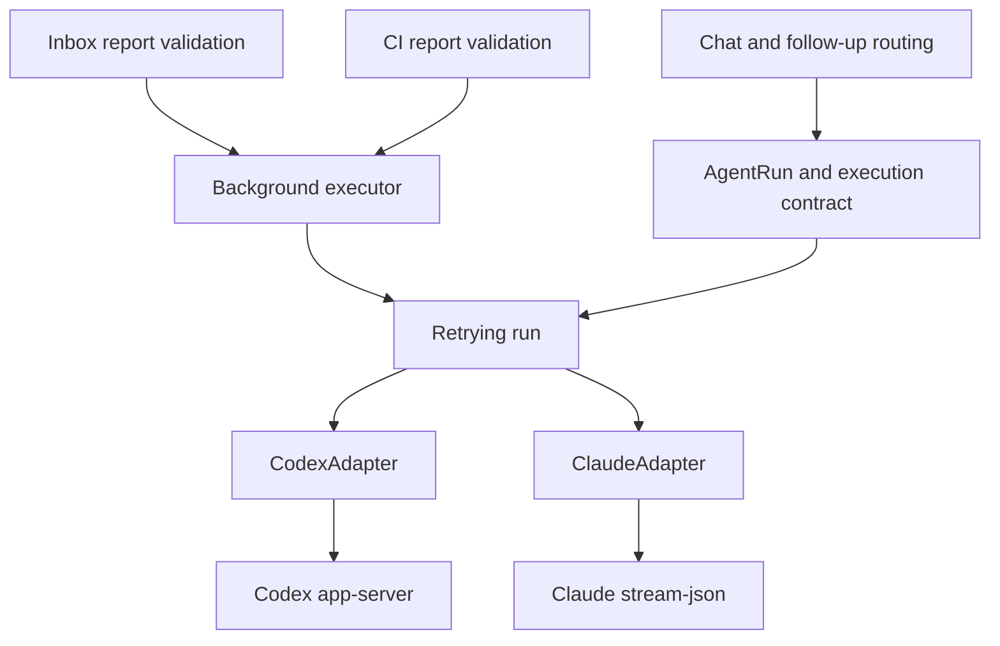

# Agent execution contract

Codex `app-server` and Claude Code expose the same execution
contract. Chat rendering, follow-up delivery, retries, and background analysis
consume this contract without selecting behavior by agent name. Claude streaming
input requires Claude Code 2.1.302 or later for correlated completion receipts.

## Capabilities and events

`AgentExecutionCapabilities` in `src/agent/types.ts` describes execution semantics.
`src/agent/backend-spec.ts` is the single static descriptor for launch fields,
state-directory environment names, session identity/history, permission display,
model catalogs and provider support. `src/agent/capability.ts` combines that
descriptor with profile-specific permission ceilings. The adapter declares its
execution capabilities and attaches them to every run. The retry wrapper retains
the current attempt's declaration. Profile-time discovery uses the same
declarations in `src/agent/{codex,claude}/capabilities.ts`.

| Contract | Codex app-server | Claude Code |
| --- | --- | --- |
| `finalAnswer` | `separate-event` | `separate-event` |
| `input` | `active-turn` | `active-session` |
| Native session | Codex thread | Claude session |

- `text` is public progress; `final_text` is the authoritative answer. Provisional
  message deltas are not final answers. A `done` event with normal termination is
  required before a background result can be delivered.
- `error.failureKind` distinguishes rate limits, quota, authentication, ambiguous
  input delivery, and other runtime failures. Both adapters normalize native
  text errors at their boundary. Explicit kinds take precedence over message text.
- The native translators, watchdogs, session/thread IDs, sandbox and permission
  policies remain owned by their adapters and the existing runtime policy layer.
  No session is converted between engines.

Claude holds the last assistant message's text blocks until the native `result`
arrives. Earlier messages and text preceding tool calls become public progress;
the authoritative result is emitted only once as `final_text`, followed by usage
and completion. Subagent results and orphaned task notifications cannot terminate
the parent. An error or missing result never promotes buffered text to an answer.
Completion waits until the result covers all supplemental input IDs. A late
supplement may therefore continue in a subsequent native turn of the same session.

## Input delivery

Business code uses `supportsRunInput()` and `sendRunInput()` from
`src/agent/execution.ts`. Input includes a unique message ID; the receipt echoes
that ID and has one of these states:

| Receipt | Caller action |
| --- | --- |
| `accepted` | Inform the user that the transport received it; model processing may still be pending. The scope is `active-turn` or `active-session`. |
| `inactive` | Queue a new run in the same scope, unless cancelled. |
| `unsupported` | Use the ordinary pending-message queue. |
| `unknown` | Report uncertain delivery; never automatically replay the message. |

Lost and mismatched receipts are `unknown`. The retry wrapper also prevents
restarting a failed attempt while an input acknowledgement is pending or delivery
has become uncertain. During backoff, after termination, and after stop, input
returns `inactive`. Follow-up preparation remains serialized per run, and the
router still checks scope and cancellation generation before and after delivery.

`steer()` is retained as a deprecated compatibility hook for existing adapter
callers. Its legacy fallback is isolated in `execution.ts`; business modules do
not call it. Adapters without a capability declaration keep streamed rendering
and cannot execute background analysis. Their existing `steer()` input continues
to work through the fallback without claiming new features.

## Background tasks and model services

`src/runtime/background-executor.ts` owns deadlines, cancellation, retries,
authoritative result collection, and process cleanup. It accepts any adapter and
run that both declare `finalAnswer: separate-event`. It returns plain answer text
and usage; it knows nothing about Lark cards, inbox items, GitLab, or report JSON.
The inbox/CI report validator owns the report schema and safe user-facing errors.

Background profile eligibility requires a personal profile with the final-answer
contract. Both Codex and Claude declare it. Inbox and CI use this shared check;
the inbox UI lists eligible personal profiles using backend capability metadata.

Direct Responses API screening uses the independent `modelServices` registry.
`src/model-service/config.ts` defines endpoint, default model and credential
references; `service.ts` resolves them without reading agent configuration.
Inbox `triageService` selects a service independently of `executorProfile`.
Missing or invalid explicit services fail without credential fallback. An absent
or empty `triageModel` uses the selected service's model, independent of
`analysisModel`. The local UI and CLI manage this registry without returning
resolved credentials. See [model services](model-services.md).

Without `triageService`, the legacy `triageProfile`/executor routing still uses
`loadProfileModelService()` and `src/agent/codex/model-service.ts`. Its credential
precedence and model defaults remain compatible. `loadAnalysisProvider` remains
a legacy alias. No credentials are automatically copied, and Claude's native
Anthropic configuration is not interpreted as a Responses API service.

`backgroundModelSettings()` resolves native task models without reading direct
API credentials. An omitted legacy Codex model keeps Flash/max; an empty model
inherits profile/CLI settings. Claude omitted/empty models inherit Claude's own
settings. CI continues to request max effort through the existing model resolver.
Existing explicit model names are preserved; when changing engines, select a
model supported by the destination engine or clear the override.

## Chat output, commands and preferences

`src/bot/channel.ts` handles message intake and run setup. It passes an event
subscription to `run-output.ts`, which owns progress streams, COT fallback,
empty-message cleanup and final delivery. Card and Markdown streams share the
same progress lifecycle. `run-stream.ts` reduces agent events and maintains the
idle watchdog; rendering keeps the run's execution capabilities and live display
preferences separate. Changes to output should retain the slow-producer,
missing-receipt, retry and terminal-event regressions.

`src/commands/catalog.ts` is a data-only catalogue of command aliases, access
requirements, argument parsing, pending-message policy and help text. Intake and
help rendering read this catalogue without loading command handlers. The typed
handler table in `commands/index.ts` must cover every catalogue entry. Text and
card commands use the same authorization and dispatch function; domain handlers
live in the adjacent workspace, resume, config, account, access, lifecycle,
doctor and meeting modules. Existing command context type exports remain valid.
The `recent` handler reads the profile session catalog without spawning an
agent; active runs are omitted and non-admin callers are limited to their
current chat/topic scope.

Chat forms translate CardKit string fields before calling the shared preference
validator in `src/config/preferences.ts`; the web API supplies JSON fields.
Both use the same model validation, bounds and identity/save transaction. A live
identity change is rolled back on failure, including a partially applied policy;
offline edits apply identity settings on the profile's next startup. Omitted
meeting settings are not written back from a stale snapshot. Surface-specific
card delays and HTTP error responses remain at their respective boundaries.

## Extending the contract

When migrating another adapter, declare only verified semantics, attach them to
each run, and translate native events/receipts at the adapter boundary. Run the
contract tests plus transport process tests and chat/background regressions.
In particular, verify final versus progress text, stop and completion races,
ambiguous receipts, retries, and deadline propagation. Native question handling
and additional direct model protocols are separate future changes.

## Backend-owned configuration and protocols

Backend descriptors supply shared capability metadata; launch codecs live with
the backend. The configuration and bootstrap layers iterate the registry rather
than branching on backend names. Native model readers and provider wire bindings
are separate from model preference resolution. Antigravity and Pi share process
ownership, JSONL framing, termination and deadline handling while keeping their
event translators and launch protocols independent. Static contract tests reject
backend-name branches in shared consumers and internal import cycles.
