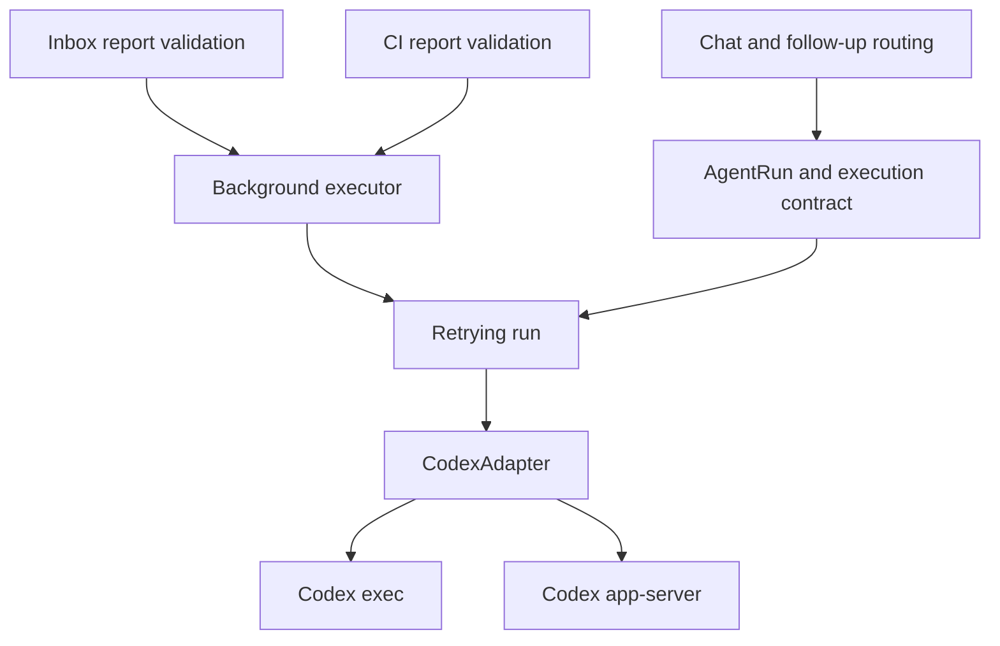

# Agent execution contract

Codex `exec` and `app-server` expose the same execution contract. Chat rendering,
follow-up delivery, retries, and background analysis consume this contract without
selecting behavior by agent name. Claude retains its existing adapter and legacy
input path; this migration does not enable new Claude features.

## Capabilities and events

`AgentExecutionCapabilities` in `src/agent/types.ts` describes execution semantics,
separately from the session identity and access policy in `src/agent/capability.ts`.
The adapter declares its capabilities and attaches them to every run. The retry
wrapper retains the current attempt's declaration. Profile-time discovery uses
the same declaration in `src/agent/codex/capabilities.ts`.

| Contract | Codex exec | Codex app-server |
| --- | --- | --- |
| `finalAnswer` | `separate-event` | `separate-event` |
| `input` | `unsupported` | `active-turn` |
| Native session | Codex thread | Codex thread |

- `text` is public progress; `final_text` is the authoritative answer. Provisional
  message deltas are not final answers. A `done` event with normal termination is
  required before a background result can be delivered.
- `error.failureKind` distinguishes rate limits, quota, authentication, ambiguous
  input delivery, and other runtime failures. The Codex adapter normalizes legacy
  text errors at its boundary. Explicit kinds take precedence over message text.
- The native translators, watchdogs, session/thread IDs, sandbox and permission
  policies remain owned by their adapters and the existing runtime policy layer.
  No session is converted between engines.

## Input delivery

Business code uses `supportsRunInput()` and `sendRunInput()` from
`src/agent/execution.ts`. Input includes a unique message ID; the receipt echoes
that ID and has one of these states:

| Receipt | Caller action |
| --- | --- |
| `accepted` | Inform the user that the transport received it; model processing may still be pending. The scope is `active-turn` or `active-session`. |
| `inactive` | Queue a new run in the same scope, unless cancelled. |
| `unsupported` | Use the ordinary pending-message queue. |
| `unknown` | Report uncertain delivery; never automatically replay the message. |

Lost and mismatched receipts are `unknown`. The retry wrapper also prevents
restarting a failed attempt while an input acknowledgement is pending or delivery
has become uncertain. During backoff, after termination, and after stop, input
returns `inactive`. Follow-up preparation remains serialized per run, and the
router still checks scope and cancellation generation before and after delivery.

`steer()` is retained as a deprecated compatibility hook for existing adapter
callers. Its legacy fallback is isolated in `execution.ts`; business modules do
not call it. Adapters without a capability declaration keep streamed rendering
and cannot execute background analysis. Their existing `steer()` input continues
to work through the fallback without claiming new features.

## Background tasks and model services

`src/runtime/background-executor.ts` owns deadlines, cancellation, retries,
authoritative result collection, and process cleanup. It accepts any adapter and
run that both declare `finalAnswer: separate-event`. It returns plain answer text
and usage; it knows nothing about Lark cards, inbox items, GitLab, or report JSON.
The inbox/CI report validator owns the report schema and safe user-facing errors.

Background profile eligibility requires a personal profile with the final-answer
contract. Only Codex currently declares it. Inbox and CI use this shared check;
their existing UI choices remain unchanged.

Direct Responses API screening is separate from agent execution:
`loadProfileModelService()` resolves a model endpoint, model, and credentials.
The current implementation reuses Codex configuration via
`src/agent/codex/model-service.ts`, preserving credential precedence, HTTPS checks,
and model overrides. This is an internal boundary, not a new configuration format
or a second credential store. `loadAnalysisProvider` remains an alias for existing
callers.

## Extending the contract

When migrating another adapter, declare only verified semantics, attach them to
each run, and translate native events/receipts at the adapter boundary. Run the
contract tests plus transport process tests and chat/background regressions.
In particular, verify final versus progress text, stop and completion races,
ambiguous receipts, retries, and deadline propagation. Native question handling
and provider-independent model configuration are separate future changes.
